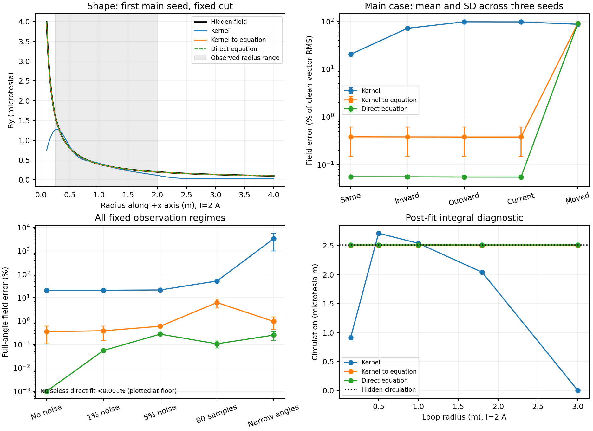

# From a hidden magnetic world to a learned analytic field

**Can the sensor workflow discover the shape of a magnetic field when its
physical response formula is withheld?** We ran that experiment, with an
ideal straight wire as the hidden world. The learner received Cartesian
positions, signed current and three magnetic components. A Gaussian kernel
learned those samples; a general algebraic search then extracted an explicit
field from the kernel's values at the training positions.

With 1% measurement noise, the extracted field averaged **0.383%** error on
independent same-domain positions, against **20.439%** for the kernel. It
retained that accuracy at unseen radii and currents. Direct extraction from
the observations was better still, at **0.056%**. This verifies recovery of
the field's algebraic structure within the supplied search grammar; it does
not establish a benefit from inserting a kernel before equation discovery.

The [fixed protocol](PROTOCOL.md) was written before the first full run.
[All results and the matched sensor-stage audit](results/RESULTS.md),
[machine-readable fits and diagnostics](results/results.json), and
[saved observations and predictions](results/predictions.npz) accompany it.
All five conditions and all three fixed seeds are retained.



## The hidden world and the recovered function

The simulator uses an infinite z-directed wire through the origin, with
positions in metres, current in amperes and outputs in microtesla:

$$
\mathbf B_*(x,y,I)=\frac{0.2 I}{x^2+y^2}
\begin{pmatrix}-y\\x\\0\end{pmatrix}.
$$

The coefficient 0.2 is chosen by the simulator to represent the usual ideal
wire response in these units; it is not an experimentally estimated constant.
The wire axis is excluded. This is a deliberately simplified magnetic world,
not a finite wire with return paths or a simulation of the historical
experiments available to Maxwell.

For the **first fixed main seed**, the extracted function is

$$
\mathbf B_{\mathrm{learned}}(x,y,I)=
\frac{I}{1.00305995x^2+y^2}
\begin{pmatrix}
-0.198992252y\\
\phantom{-}0.199601092x\\
0
\end{pmatrix}.
$$

These displayed coefficients are rounded for reading. Every prediction and
score uses the unrounded saved coefficients. We do not replace the learned
coefficients by 0.2 or force the denominator coefficients to agree.

The same monomial support was selected in all 15 fits. Thus current
proportionality and inverse-distance scaling emerge exactly in the selected
expressions, while circular symmetry is approximate. In particular,

$$
\mathbf B_{\mathrm{learned}}(s x,s y,I)
=s^{-1}\mathbf B_{\mathrm{learned}}(x,y,I),\qquad s>0.
$$

The extracted field is close to the generating law but is a different
function at finite data and noise. Three seeds and this finite search do not
establish asymptotic convergence or uniqueness among all possible functions.

## What the learner is given

Training comprises 480 independent observations, with 180 independent
validation observations, at radii 0.25--2 m and signed currents with
magnitudes 0.5--4 A. One condition uses only 80 training points. Noise is
independent Gaussian noise on each component. Its standard deviation is 0,
1% or 5% of the pooled clean training component RMS. The learner receives
neither the clean observations nor that noise scale.

The inputs contain **x, y and I**. They contain no radius, angle, inverse
distance, permeability, field derivatives or magnetic response formula.
The observed channels, coordinates, units, Gaussian kernel, algebraic
grammar, sparsity rule and validation criterion are supplied choices.
Selecting the right expression from that grammar is a discovery task;
choosing the grammar remains a modeling assumption.

The generator and final scorer are isolated in [world.py](world.py).
[learner.py](learner.py) imports no generator or field equation.
[run_experiment.py](run_experiment.py) fits and selects every model before
constructing its independent test labels.

## The mathematical workflow

Write an observed input as $\mathbf u=(x,y,I)$ and its noisy field as
$\mathbf b$. The Gaussian teacher is

$$
\widehat{\mathbf B}(\mathbf u)
=\overline{\mathbf b}
+\sum_{n=1}^N k(\mathbf u,\mathbf u_n)\boldsymbol\alpha_n,
\qquad
\boldsymbol\alpha=(K+\lambda\mathbb I_N)^{-1}
(Y-\mathbf 1\overline{\mathbf b}^{\mathsf T}),
$$

$$
k(\mathbf u,\mathbf v)
=\exp\!\left[-\frac{\|S^{-1}(\mathbf u-\mathbf v)\|^2}{2\ell^2}\right].
$$

Here $S$ contains training input standard deviations, $K$ is the training
kernel matrix, $Y$ contains the measured field rows, $\ell$ is a length in
standardized coordinates and $\lambda$ is the ridge penalty. Both parameters
are selected on noisy validation fields. Components share the spatial kernel
but have independent coefficients; magnetic identities are not imposed.

Next evaluate the frozen teacher at the **actual training inputs**:

$$
\mathbf t_n=\widehat{\mathbf B}(\mathbf u_n).
$$

This exactly matches the target construction in the measured dipole study.
These targets are predictions, not additional measurements.

For each total degree $d$, form a generic monomial vector

$$
\boldsymbol\phi_d(x,y,I)
=\{x^a y^b I^c:a,b,c\geq0,\ a+b+c\leq d\}.
$$

Search polynomials of degree 0--4 and rational fields of degree 1 or 2:

$$
B_{\theta,j}(\mathbf u)
=\frac{P_j(\mathbf u)}{Q(\mathbf u)}
=\frac{\boldsymbol\phi_d(\mathbf u)^{\mathsf T}\mathbf p_j}
{\boldsymbol\phi_d(\mathbf u)^{\mathsf T}\mathbf q},
\qquad j\in\{x,y,z\}.
$$

The denominator is shared between components. All monomials of the chosen
degree are initially available. At each training observation,

$$
t_{n,j}\boldsymbol\phi_d(\mathbf u_n)^{\mathsf T}\mathbf q
-\boldsymbol\phi_d(\mathbf u_n)^{\mathsf T}\mathbf p_j\approx0.
$$

Stacking these relations gives a homogeneous linear system. Column-normalized
singular-value decomposition supplies an initial coefficient vector; threshold
and refit steps select sparse supports. The largest denominator coefficient
fixes its arbitrary overall scale. Nonlinear least squares then refines the
remaining coefficients against the **teacher's field values**, rather than
only the cross-multiplied equations. Every candidate is checked against noisy
validation observations. Select the fewest coefficients within 5% of the best
validation MSE, with the fixed numerical floor in the protocol.

Finally, the selected rational expression is itself an explicit analytic
function wherever its denominator is nonzero. No further ODE integration is
needed. The first paper instead extracted a differential equation and solved
it; the sensor paper instead assembled a supplied physical response. The
common operation is to construct a new, independently executable field model
from learned targets.

The extraction is **not an exact algebraic rewriting of the Gaussian sum**.
The additional representational assumption can improve agreement with data
even while creating disagreement with the teacher between observations.

## Comparison with every stage of the sensor workflow

The automated [matched workflow audit](results/RESULTS.md#matched-workflow-audit)
reconstructs the frozen Aalto teacher and dipole field from retained arrays
and coefficients. It does not download new data, select new sensor models or
claim fresh test acquisitions. Sensor inputs are described in
[the magnetic experiment](../magnetic_mapping/README.md) and
[paper 2](../../papers/02-kernel-to-magnetostatics/kernel_to_magnetostatics.pdf).

| Stage | Hidden-wire experiment | Measured sensor experiment |
| --- | --- | --- |
| Observations | Known simulated Cartesian field and current; optional noise | Public Aalto positions and orientation-corrected vector magnetometer observations |
| Flexible predictor | Gaussian kernel in x,y,I | Gaussian kernel in x,y |
| Predictor selection | Noisy held-out validation observations | Reference instrument trial 3 |
| Targets for explicit field | Kernel predictions at actual training inputs | Kernel predictions at actual training positions |
| Representation | Generic polynomials and sparse rational expressions | Supplied equivalent magnetic dipole response |
| Constructed function | Selected rational expression | Constant background plus 100 equivalent dipoles |
| Direct-data control | Entire expression search independently repeated on observations | Same selected dipole geometry/ridge fit directly to observations |
| Held-out observations | Independent simulated acquisitions, with clean truth available for scoring | Stable trials 4--5; previously examined exploratory recordings |
| Changed conditions | New positions and currents; separately move wire without retraining | Additional instruments and trials 6--9 after environmental changes |
| Physical interpretation | Compare recovered coefficients and identities with known hidden law | Source-free field representation supplied; actual objects and source moments unknown |

The controls differ in strength: the synthetic direct control independently
selects its expression; the existing sensor control shares geometry and ridge
selected for distillation. These facts prevent a simple ranking of the two
experiments.

The retained Aalto stable reference-sensor errors are 8.090 for the kernel,
5.225 for kernel-to-dipoles and 5.312 for direct-data dipoles, in reference
recording units. Dividing by observed vector RMS gives 16.68%, 10.77% and
10.95%, respectively. Synthetic normalized errors instead use **clean** field
RMS. Noise, field magnitude, geometry and observation channels differ, so the
percentages describe each experiment and do not measure relative difficulty.

## What the tests show

Across three seeds, the main 1%-noise run yields mean clean-field errors:

| Independent test | Kernel | Kernel to expression | Direct expression |
| --- | ---: | ---: | ---: |
| Same observed domain | 20.439% | 0.383% | 0.056% |
| Inward: radii 0.10--0.22 m | 71.538% | 0.381% | 0.056% |
| Outward: radii 2.3--4 m | 97.839% | 0.379% | 0.055% |
| New currents: magnitudes 5--8 A | 97.366% | 0.380% | 0.055% |
| Wire moved without retraining | 86.991% | 89.869% | 89.999% |

The flexible teacher has appreciable interpolation error for this sharp
three-input field with 480 samples. Its minimum candidate length, 0.35, is
selected in all main runs: kernel hyperparameters have not been shown to be
globally optimal. The extracted law generalizes because its selected
homogeneous structure extends across distance and current, whereas Gaussian
basis functions decay away from their training support. With only 80 training
points, the distilled error rises to 6.231%; the direct fit remains at 0.105%.
The kernel can therefore discard useful information before extraction.

Narrow-angle observations produce a mean 0.158% distilled error within the
observed wedge, but 0.961% across all angles. The kernel's full-angle
extrapolation is unstable. These are successes within a favorable low-degree
grammar, not evidence that limited observations uniquely determine a law.

The moved-wire test deliberately omits the changing source position from the
model inputs. Its failure demonstrates missing conditioning information:
knowing a field function for one configuration does not predict an unobserved
new configuration. A separate exact-data test changes both source position
and strength and confirms that the generic rational search can represent and
recover the shifted law when observations of that configuration are supplied.

In the nonmagnetic control, the same procedure recovers an ordinary polynomial
with a constant denominator and a nonzero Bz. It does not force every dataset
into a wire-like shape. The recovered polynomial predicts unseen distances
and currents with relative error about $4.9\times10^{-8}$.

## How close is the extracted function to magnetic theory?

All extracted wire functions have the selected form

$$
\mathbf B_\theta=
\frac{I}{d x^2+e y^2}(-a y,b x,0).
$$

Writing $Q=d x^2+e y^2$, differentiation gives

$$
\partial_x B_x+\partial_y B_y
=\frac{2Ixy(ad-be)}{Q^2},
$$

$$
\partial_x B_y-\partial_y B_x
=\frac{I(a-b)(d x^2-e y^2)}{Q^2}.
$$

The equalities $a=b$ and $d=e$ would recover the exact ideal-wire shape, up to
the overall field coefficient. They were not imposed. In the first main fit,
the spatial derivative relative error is 0.528%, the normalized planar
divergence is $1.76\times10^{-7}$ and the normalized planar curl is 0.00142.
The normalization is the norm of the oracle spatial derivative tensor.
The kernel's derivative error is 63.59%. These are post-fit model diagnostics,
not measured spatial gradients or independent physical evidence.

At I=2 A, the learned loop circulation is 2.50061 microtesla metres, compared
with the hidden value 2.51327. It is radius-independent in these extracted
expressions because of their selected homogeneity. Constant circulation alone
does not establish the correct angular shape. Local curl-free behavior away
from the excluded wire axis is compatible with nonzero circulation around it;
the axis is a singularity inside the loop.

Only a static planar slice and controllable current were observed. There are
no electric fields, time derivatives, charge distributions or measured
z-dependence. The experiment recovers a particular magnetic response and
checks some consequences; it cannot identify the full Maxwell system or the
room's magnetic sources. It also does not test all alternative mathematical
grammars or establish that the kernel is needed. Its useful result is a
concrete, testable example of data -> learned predictor -> explicit function,
with the gap between a recovered shape and an exact theoretical law measured
at each stage.

## Reproduce

From the repository root:

```powershell
python experiments/hidden_wire/run_experiment.py
python -m pytest experiments/hidden_wire/tests -q
python scripts/check_repository.py
```

The simulation needs no network or raw dataset cache. The matched sensor
comparison uses the checked-in Aalto result arrays. Six tests check independent
field values and calculus, oracle isolation, recovery of a displaced wire,
the nonmagnetic control, saved prediction and selection reproduction, and
implementation/protocol/input hashes. The plot is also available as a
[standalone PDF](results/workflow.pdf).
